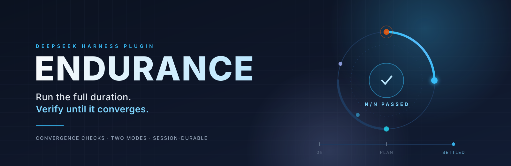
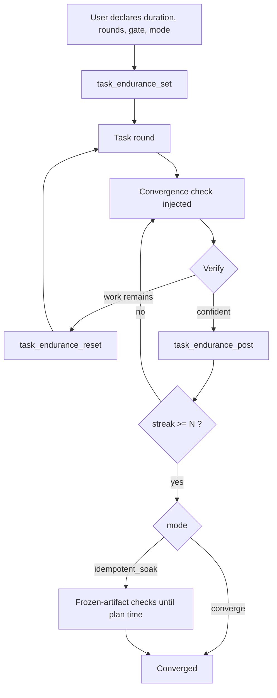

<div align="center">



# Endurance

**Run the full duration. Verify until it converges.**

A [DeepSeek Harness](https://github.com/deepseek-ai/deepseek-harness) plugin that keeps long-running tasks under real convergence checks until they genuinely settle — not until the model feels finished.

[](https://github.com/Dynesshely/dsh-plugin-endurance/actions/workflows/ci.yml)
[](LICENSE)
[](package.json)
[](https://github.com/deepseek-ai/deepseek-harness)
[](https://github.com/Dynesshely/dsh-plugin-endurance/stargazers)

</div>

---

## Introduction

Long-running agent tasks usually end when the model *says* it is done. For overnight or multi-hour work that is the wrong signal: the task ends early, the artifact is only half-verified, and you find out in the morning that the plan needs another round.

**Endurance** adds a user-declared convergence contract to a session:

- a **plan duration** (for example "8h"),
- **N consecutive passing checks**,
- a **confidence gate** (for example 85%),
- and a **convergence mode** chosen by the user.

After the model registers the run, Endurance injects model-authored verification prompts at the end of task rounds. The model reports confidence with `task_endurance_post`, or asks to keep working with `task_endurance_reset`. The run only settles on the user's terms.

| Mode | Behavior |
| --- | --- |
| `converge` | Settles as soon as N consecutive checks pass. The plan duration is a planning reference. |
| `idempotent_soak` | First reaches N consecutive passes, then keeps frozen-artifact checks on a fixed cadence until the plan time; any rework requires `reset`. |

The mode is user-owned. When the user has not clearly chosen one, the model **asks first** — `task_endurance_set` rejects a missing mode with `ENDURANCE_MODE_REQUIRED`.

### The five tools

| Tool | Purpose |
| --- | --- |
| `task_endurance_set` | Register a run: duration, consecutive passes, gate, check prompt, mode, optional idempotent interval. |
| `task_endurance_post` | Report this round's confidence (0–100) and evidence. |
| `task_endurance_reset` | Keep working; clears the consecutive-pass streak. |
| `task_endurance_status` | Read mode, phase, streak, plan progress, and recent checks. |
| `task_endurance_cancel` | Stop the run — only on an explicit user request. |

## How it works

1. The user states the plan duration, the required consecutive passes, the confidence gate, and the convergence mode.
2. In that human turn, the model calls `task_endurance_set` with a **model-authored** check prompt template.
3. The model completes one full task round. If the set turn contained no real task work, Endurance sends a one-shot **kickoff** prompt instead of a premature check.
4. At each idle boundary, Endurance renders the check prompt with live run data (`$endurance_id`, `$endurance_gate`, `$endurance_deadline`, …), appends a status footer, and injects it as its own user message.
5. The model verifies, then calls `task_endurance_post` with a confidence or `task_endurance_reset` to continue.
6. **`converge`** settles immediately when the streak is met. **`idempotent_soak`** freezes the artifact, re-verifies on an interval until the plan time, and settles there; a regression returns the run to active checks.



### Guardrails

- **Turn-bound authority.** `set` / `cancel` require a direct human turn on a root agent; `post` / `reset` require the exact injected check round. A model cannot self-arm a multi-hour run or pad its own streak.
- **One count per round.** A round counts once; duplicate posts return `counted: false`; reset takes precedence over a same-round post.
- **Bounded execution.** Check rounds, hard deadlines, unanswered prompts, and consecutive errors all have safety limits, so an unattended night cannot loop forever.
- **Cooperative scheduling.** Checks are injected only when the agent is genuinely idle; a background shell or long-running process does not count as busy. Goal rounds and human messages take precedence.
- **Durable by session log.** Run state is persisted as `plugin:dsh-plugin-endurance/state` records in the owning session, so restart, resume, and reload all recover the same run.

The full contract — state machine, tool schemas, prompt placeholders, error codes, and security limits — lives in [`docs/DESIGN.md`](docs/DESIGN.md).

## How to install

**Requirements:** DeepSeek Harness `0.2.2` (or a compatible 0.2.x), Node.js 20+.

Endurance is a **host-side** plugin: it registers tools, tracks runs, and drives sessions entirely on the Host. It has no client UI yet (the status row and `/endurance` commands arrive in M2), so it works in Web, Desktop, headless, and SDK profiles wherever the bundle is installed.

### DeepSeek Harness Web

```bash
dsh plugin --profile web add /absolute/path/to/dsh-plugin-endurance
```

This links the bundle into the profile and adds `dsh-plugin-endurance` to its bundle list. Enable the `endurance` row on the Plugins page — the host half applies without a full DSH restart.

Optional overrides in the profile's `cordis.patch.yml`:

```yaml
- id: endurance
  config:
    maxDurationHours: 24
    maxChecks: 100
    minCheckGapMs: 30000
```

### DeepSeek Harness Desktop

Desktop runs the same Web workspace in an Electron shell and keeps its **own profile** (`desktop`), separate from CLI profiles. Install the bundle with either of these:

**Option A — Plugins page (recommended)**

1. Open Desktop and go to **Plugins**.
2. Install `dsh-plugin-endurance` from its local directory, repository, or package spec.
3. Enable the `endurance` row. The shared plugin manager applies the host half; if Desktop asks to restart, quit and reopen the application (running tasks are warned before quitting).

**Option B — Desktop's own `dsh` command**

Desktop can install a matching `dsh` command from its application menu: **Manage dsh Command… → Install**. Then:

1. Launch Desktop once so Desktop initializes `$DSH_HOME/profiles/desktop`, then **fully quit** the application (use Quit, not just close the window).
2. Install into the Desktop profile:

   ```bash
   dsh plugin --profile desktop add /absolute/path/to/dsh-plugin-endurance
   ```

3. Reopen Desktop, open **Plugins**, and enable the `endurance` row.

Notes for Desktop:

- Use the `dsh` command installed by Desktop. An npm-installed `dsh` manages ordinary CLI profiles but cannot mutate the Desktop profile or its executable package graph.
- Desktop shares sessions, settings, credentials, and workspaces with CLI dsh, but **plugin activation is per profile**: installing for Web does not install for Desktop.
- The Desktop `dsh` command can manage the `desktop` profile while the application is quit, but it cannot boot that profile.

### Quick start

After enabling the plugin, ask in a session:

```text
Plan a long-running task: duration 8h, require 3 consecutive checks at 85% or above,
and keep idempotent verification every hour until the plan time.
```

> Already running? Toggling the `endurance` row is enough for the host tools to appear; new tool declarations are appended on the next model step.

## How to contribute

Issues and pull requests are welcome.

1. **Start with an issue.** Describe the goal, the acceptance criteria, and the affected behavior. For semantic changes to durations, modes, or authorization, discuss them in the issue first.
2. **Keep the design and code in sync.** [`docs/DESIGN.md`](docs/DESIGN.md) is the source of truth for tool contracts, state transitions, prompt placeholders, and safety limits. Update it in the same PR.
3. **Branch and test.** Use `feat/<issue>-<slug>`, `fix/<issue>-<slug>`, or `chore/<issue>-<slug>`; run `npm test` and `npm run check` before opening the PR.
4. **Respect the boundaries.** The plugin is zero-build ESM JavaScript: no new runtime dependencies, no private absolute paths or credentials in code, docs, or commits.
5. **Anything user-visible needs a test.** Pure domain logic, tool contracts, and the injection driver all have `node:test` coverage; extend it rather than describing the change in prose.

```bash
npm test          # node --test
npm run check     # syntax checks
npm run demo      # deterministic end-to-end demo of the loop
```

## Structure

```text
dsh-plugin-endurance/
├── index.js                 # host entry re-exports
├── cordis.patch.yml         # bundle row: id=endurance
├── src/
│   ├── plugin.js            # wiring: tools, driver, system-prompt guidance
│   ├── host.js              # host Session module bridge + plugin-record writer
│   ├── config.js            # config clamping
│   ├── domain.js            # pure state machine: modes, phases, limits, snapshots
│   ├── prompt.js            # placeholder rendering, status footer, kickoff copy
│   ├── authority.js         # human-turn / check-round matching, work evidence
│   ├── service.js           # per-session run registry and persistence
│   ├── driver.js            # idle/tick scheduling, injection, recovery
│   └── tools.js             # the five model-facing tools
├── test/                    # domain, prompt, tools, driver, host-bridge tests
├── tools/demo-endurance.mjs # deterministic loop demo (npm run demo)
├── docs/DESIGN.md           # full design and contract
├── locale/                  # bundle metadata (en / zh)
├── assets/                  # README banner
└── icon.svg
```

## Stars History (dark mode)

<div align="center">

[](https://star-history.com/#Dynesshely/dsh-plugin-endurance&Date)

</div>

## License

MIT © [Dynesshely](https://github.com/Dynesshely). See [LICENSE](LICENSE).
